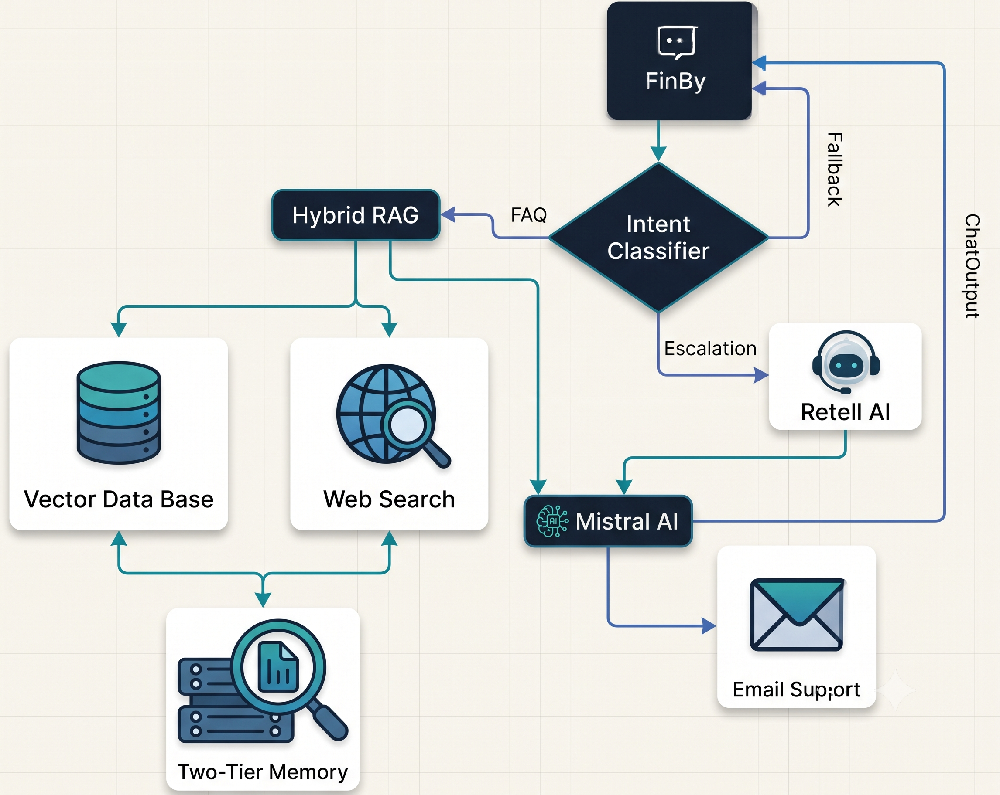

# FinBot — AI-Powered Banking Assistant

FinBot is an AI-powered banking assistant designed to help users resolve banking-related queries through intelligent, context-aware conversations. It combines fine-tuned language models with Retrieval-Augmented Generation (RAG) to provide relevant responses and support common banking tasks.

## Overview

FinBot aims to make banking support more accessible and efficient by allowing users to interact with an AI assistant through a conversational interface. It uses natural language processing and retrieval-based context to improve the relevance of its responses.

The project also explores multilingual interaction, voice-based communication, and automated issue escalation for cases such as suspected fraud or unauthorized transactions.

## Features

- **Intelligent Query Resolution:** Uses fine-tuned language models to understand and respond to banking-related queries.
- **Context-Aware Responses:** Uses Retrieval-Augmented Generation (RAG) to provide responses informed by relevant retrieved information.
- **Multilingual Support:** Designed to support interactions in multiple languages through API integration.
- **Issue Escalation:** Supports a workflow for raising support tickets for fraud-related or unauthorized transactions.
- **Voice Interaction:** Includes a voice interaction interface; voice recognition is simulated in the demo.
- **Interactive User Interface:** Provides a conversational interface designed for a smooth user experience.

## AI and Machine Learning

### DistilBERT Fine-Tuning

DistilBERT is fine-tuned for banking-related natural language processing tasks, helping the system interpret user queries and support the query-processing workflow.

### Mistral 7B Fine-Tuning

Mistral 7B is fine-tuned using parameter-efficient techniques to support natural language response generation for banking-related conversations.

### Retrieval-Augmented Generation (RAG)

FinBot uses a RAG pipeline with Pinecone for vector search and information retrieval. Retrieved context can be incorporated into the response-generation process to help produce more relevant answers.

## System Architecture

The following diagram illustrates FinBot's system architecture and the interactions between its components.



## Getting Started

### Prerequisites

- Node.js version 16.8 or later
- npm
- Required API credentials and service configuration, where applicable

### Installation

1. Clone the repository:

   ```bash
   git clone https://github.com/v12k5/FinBot1.git
   ```

2. Navigate to the project directory:

   ```bash
   cd FinBot1
   ```

3. Install the dependencies:

   ```bash
   npm install
   ```

4. Configure the required environment variables and API credentials for the services used by the project.

5. Start the development server:

   ```bash
   npm run dev
   ```

6. Open the local URL displayed in your terminal, typically `http://localhost:3000`.

## Usage

1. Launch the application.
2. Enter a banking-related question in the chat interface.
3. Review the assistant's response.
4. Explore the available conversation, language, and voice interaction features.
5. Use the issue-escalation workflow where applicable.

*Note: Some features depend on external API integration and configuration. Voice recognition is simulated in the demo.*

## Future Improvements

- Improve response accuracy across a wider range of banking queries.
- Expand multilingual capabilities.
- Integrate fully functional voice recognition and speech output.
- Enhance the retrieval pipeline and knowledge base.
- Improve issue escalation and support-ticket integration.

## License

This project is licensed under the MIT License. See the `LICENSE` file for details.

## Acknowledgements

FinBot was developed as a project exploring the application of fine-tuned language models, retrieval-augmented generation, and conversational AI to banking support.
